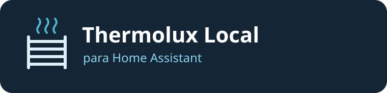

# Thermolux Local para Home Assistant

Integração comunitária em beta para controlar o **Thermolux Easy-IV** pela rede local. O card reúne o estado do toalheiro, os modos, o desligamento, as agendas e a foto da tela de descanso.

## Antes de começar

- Use **Home Assistant 2026.8.0 ou superior**, com o HACS configurado.
- Conecte o toalheiro ao Wi-Fi e deixe-o online. Tenha o **IPv4 local** em mãos. O Home Assistant precisa alcançar o aparelho na porta **TCP 8090**.
- Use uma conta administradora do Home Assistant para configurar a integração e usar o card.

A integração foi testada em duas unidades **Easy-IV** no HAOS 2026.8.0. Outros modelos ainda não foram verificados.

## 1. Instale pelo HACS

1. Abra **HACS** na barra lateral do Home Assistant.
2. Clique em **⋮ → Repositórios personalizados** (*Custom repositories*).
3. No campo **Repositório**, cole:

   ```text
   https://github.com/gabrielvsilvaa/thermolux-local
   ```

4. Em **Tipo**, selecione **Integração** (*Integration*) e clique em **Adicionar**.
5. Feche a janela, pesquise **Thermolux Local** no HACS e abra o resultado. Se ele não aparecer, limpe os filtros e confira se o repositório foi adicionado.
6. Clique em **Baixar** e confirme. A versão inicial **0.3.0** está na branch padrão.
7. **Reinicie o Home Assistant** para carregar a integração.

## 2. Cadastre o toalheiro

1. Abra **Configurações → Dispositivos e serviços → Adicionar integração**.
2. Pesquise **Thermolux Local**.
3. Informe um **nome** e o **endereço IPv4 local** do toalheiro. Confirme e, se quiser, atribua uma área.
4. Abra o dispositivo e verifique se **Modo atual** corresponde ao painel. Cada toalheiro tem suas próprias entidades, agendas e foto. Para adicionar outra unidade, repita o cadastro com o IP dela.

## 3. Adicione o card ao dashboard

1. Em **Dispositivos e serviços**, abra **Thermolux Local**.
2. Clique na **engrenagem** do toalheiro desejado.
3. Em **Adicionar card Thermolux ao dashboard**, escolha o dashboard e a aba. Clique em **Enviar**.
4. Abra a aba escolhida e confira o nome e o estado do aparelho no card.

Você também pode usar **Editar dashboard → Adicionar cartão → Por entidade**. Selecione o sensor **Modo atual** do aparelho e escolha a sugestão **Thermolux Local** na seção **Comunidade**. O botão nativo **Adicionar ao dashboard** na página do dispositivo oferece os cards padrão do Home Assistant.

## Como usar o card

| Controle | O que faz |
| --- | --- |
| **Modos** | Seleciona Degelo, 20 °C · Modo Eco, 40 °C · Baixa Temp, 50 °C · Alta Temp ou 60 °C · Esterilizar. |
| **Desligar** | Envia o comando local de parada. |
| **Agenda** | Permite criar ou excluir horários diários. Em cada agenda, configure **Ligar**, **Desligar** e **Temperatura**. Ative a agenda para executar os horários e toque em **Confirmar agendamento**. |
| **Tela de descanso** | Abre a galeria ou o seletor de arquivos. Arraste a foto, ajuste o zoom e toque em **Confirmar e enviar**. A miniatura é atualizada após a confirmação do aparelho. |

Um intervalo como **20:00 → 01:00** desliga o toalheiro à 01:00 do dia seguinte. As agendas e a foto ficam armazenadas localmente.

## Instalação manual

Copie a pasta `custom_components/thermolux_local` deste repositório para `custom_components` na configuração do Home Assistant. Reinicie e siga os passos de cadastro. Se os recursos do dashboard forem gerenciados por YAML, registre `/thermolux_local/card.js?v=0.3.0` como módulo JavaScript.

## Limitações e suporte

- **Aparelho offline:** confira o IP e se o painel está acordado. O retorno automático após falta de energia ainda está em investigação. Um evento agendado perdido enquanto o aparelho está offline não é repetido automaticamente.
- **Card ausente após instalar:** confirme o cadastro do dispositivo e recarregue o dashboard. Em modo YAML, confira o recurso JavaScript.
- **Encontrou um problema?** Abra uma [issue](https://github.com/gabrielvsilvaa/thermolux-local/issues) com o modelo, a versão do Home Assistant e os passos para reproduzir. Remova IPs, fotos e credenciais dos anexos.

Projeto comunitário independente, sem vínculo com a Thermolux ou com o Home Assistant.
